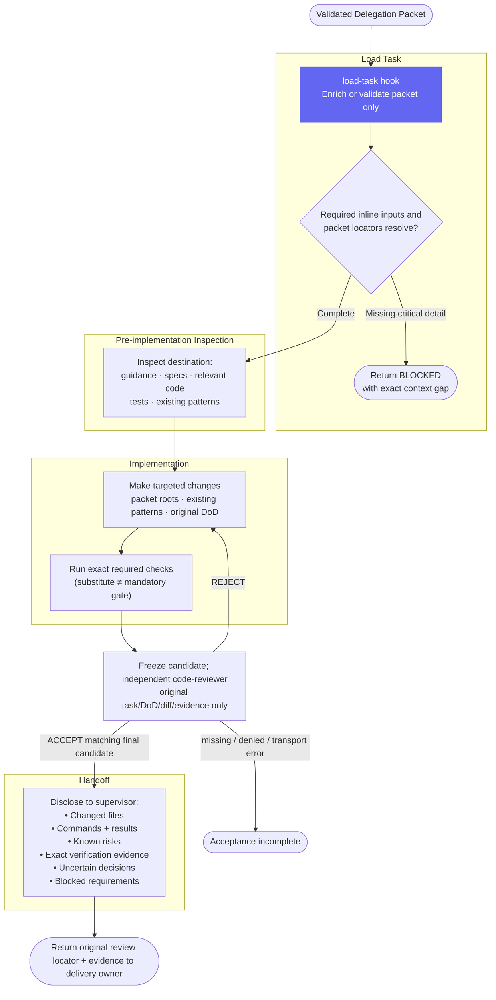

# Implementor — Workflow Diagram

`agents/implementor.md` · profile: `worker` · mode: `all` · isolation: `sandbox`

The Implementor owns one atomic task or plan phase: diagnosis, edits, tests and
remediations in one session. It dispatches only independent code-reviewer and
never self-certifies. Direct entry requires no planner or intermediate supervisor.
Its intake follows the fail-closed packet contract defined normatively in
[`docs/specs/delegation-and-evaluation.md`](../specs/delegation-and-evaluation.md); the diagram assumes required
inputs resolved before normal repository inspection.

## Full Workflow

## Hook Summary

| Hook | When | Purpose |
|---|---|---|
| `load-task` | Start | Enrich or validate supplied packet context; never reconstruct a known locator |
| `record-ledger` | Direct atomic only | Existing micro checkpoint; plan phases report history to macro owner |
| `pre/post-delegate-code-reviewer` | Actual review dispatch only | Implementor, or parent fallback, never both |

## Scope Constraints

| Allowed | Not Allowed |
|---|---|
| File edits within permitted paths | Committing or deploying changes |
| Running required checks | Authenticating with external services |
| Reporting evidence to supervisor | Starting long-lived services (unless explicitly granted) |
| Running strongest available additional checks | Redefining product architecture |
| | Silently broadening scope |
| Independent code-reviewer dispatch | Delegating implementation, diagnosis or QA |

## Authority Boundary

If nesting is unavailable, the parent dispatches the reviewer on the same frozen
candidate and returns its unfiltered result to the same implementor. Reuse reviewer
continuation for remediations. [Ownership contract](../specs/supervision-and-delivery.md#phase-ownership).
